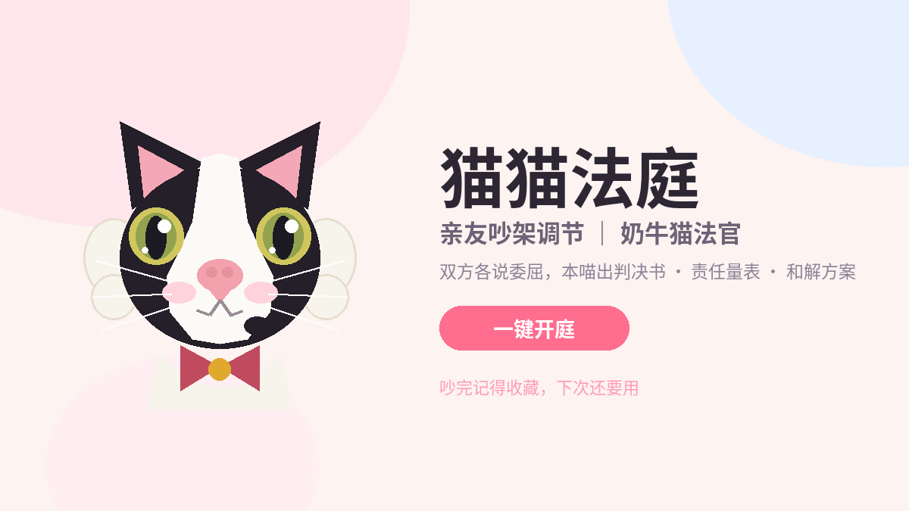
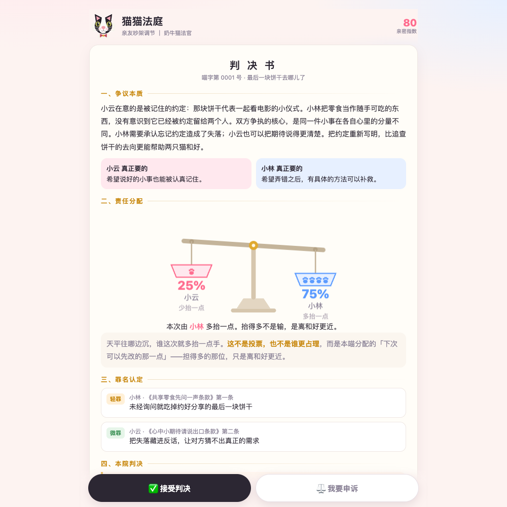

# 🐾 猫猫法庭 Cat Court

[在线体验虚构示例](https://xlmsyq.github.io/cat-court/) · [GitHub 仓库](https://github.com/xlmsyq/cat-court)

一只奶牛猫法官，帮情侣 / 室友 / 同事化解「说大不大，但真的很委屈」的小矛盾。

双方各自写下委屈 → 猫猫法官出一份正式《判决书》：争议本质、责任分配（猫爪天平）、
可爱条款罪名认定、可执行的和解步骤、一段可以直接复制发给对方的话。
不服可以申诉二审；接受判决和完成和解任务会提升亲密指数。



## 它和一般「AI 调解」的区别

- **不做裁判秀**：判决目标不是分输赢，是让两个人和好
- **责任用天平表达，不用进度条**。进度条容易被读成「谁的色块长 = 谁占理 / 谁票多」，
  天平的物理直觉是「沉下去的那一边扛得更重」，而且界面上明说：这不是投票
- **Prompt 里写死了几条铁律**：不说教、不贴「有毒关系 / 分手吧」标签、不做心理诊断；
  一方在生病或状态很差时，判决必须给「低能耗版」补偿方案；责任占比可以不对等，
  但占比小的那位也一定要留台阶
- **应用不落库**：后端不将双方陈述写入数据库，亲密指数与任务进度只存浏览器 localStorage

## 快速开始

```bash
pip install -r requirements.txt

export ANTHROPIC_API_KEY=sk-ant-xxx
# 可选：任何 Anthropic Messages 协议兼容网关
# export ANTHROPIC_BASE_URL=https://your-gateway/v1
# export CAT_COURT_MODEL=claude-sonnet-4-20250514

uvicorn app:app --host 0.0.0.0 --port 8000
```

打开 http://localhost:8000 即可。无需 API Key 也可以点击「看一眼判决书长什么样」预览界面。

也可复制 `.env.example` 为 `.env`，填好配置后运行 `uvicorn app:app --env-file .env --port 8000`。API Key 始终只保存在服务端环境变量中。

## GitHub Pages 静态演示

`docs/index.html` 是零依赖的纯前端互动示例，可直接打开，也可在 GitHub 仓库的 Settings → Pages 选择 `main` 分支和 `/docs` 目录发布。页面使用预先写好的虚构案情与判决，支持责任天平、复制示例和本机和解任务演示；不调用模型，也不提交陈述。真实 AI 判决和申诉需按上文自行部署完整后端，API Key 只能配置在服务端。

## 测试

```bash
pip install -r requirements.txt pytest
python -m pytest -q
```

所有演示人物、纠纷陈述与内置判决均为虚构内容。

## 项目结构

```
app.py               FastAPI 后端：judge / appeal 接口 + prompt + 结果归一化
static/index.html    完整应用前端：猫法官 SVG、判决书排版、天平组件、亲密指数
docs/index.html      GitHub Pages 纯前端示例：虚构案情、本机互动，无模型调用
```

前端是零依赖的单文件 HTML（原生 JS + CSS），猫法官形象是手写 SVG，
外形设定为：黑头 + 中央白色闪电纹 + 白口罩 + 大粉鼻 + 下唇右侧黑痣 + 榛绿色眼睛。

## 隐私与部署

点击「看一眼判决书长什么样」仅在浏览器展示内置虚构示例，不调用模型接口。提交真实判决或上诉时，双方输入会发往你部署的后端，再转发至你配置的 Anthropic 或兼容网关；模型服务商和部署平台的日志、留存政策需要自行核对。

该版本没有账号认证或限流，公开运行后端前请配置适合自己场景的访问控制，避免接口被任意调用而产生模型费用。详细说明见 [SECURITY.md](SECURITY.md)。

## API

`POST /api/judge`

```json
{
  "party_a": { "name": "小云", "statement": "……" },
  "party_b": { "name": "小林", "statement": "……" },
  "appeal": "可选：上诉理由",
  "previous_verdict": {}
}
```

返回判决书 JSON：`essence` / `blame` / `charges` / `verdict` /
`reconcile_steps` / `message_to_partner` / `intimacy_delta` / `tasks`。

## 截图



## 免责声明

猫猫法庭只负责调解小矛盾，不构成任何专业心理或医疗建议。
吵得太大的时候，请先抱一下，再来找本喵。

## License

MIT
